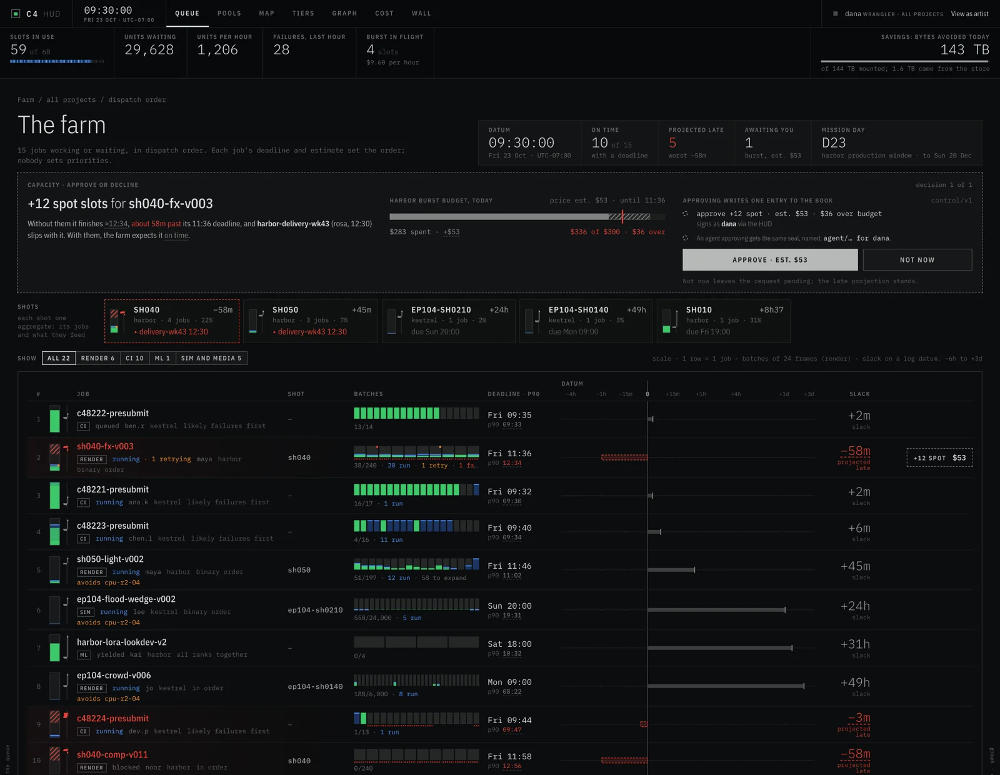

# The Cinema Content Creation Cloud: c4-operator

The render queue, reimagined around content identity, deadlines, provenance
and agents. c4-operator turns a Kubernetes cluster into one farm for
rendering, CI and machine learning, where every tree a pod reads or writes
is a C4 view: a directory tree in which each file is named by its C4 ID
(standardized as SMPTE ST 2114, and in production use since before the
standard), the SHA-512 of its bytes. Each object leaves the store
about once however many pods read it, work is ordered by deadlines instead
of priorities, every output is a version, every step is signed by whoever
did it, and agents have the same controls as people.
C4 is the short form of The Cinema Content Creation Cloud
([cccc.io](https://cccc.io)).

- **Views, not volumes.** A pod mounts exactly the files it needs through a
  CSI driver, as an overlay of layers that every pod on the node shares. The
  bytes come through node, peer and regional caches that read each object
  from the store about once, however many pods ask for it.
- **Outputs are versions.** When a pod exits, what it wrote is captured as a
  changeset over the view it mounted, and a job's output is one view folded
  from its units' changesets.
- **Isolation by project.** A project's pods can mount only what its own
  store holds; vendors see exactly the paths they were granted, and a
  revoked grant stops new mounts at once.
- **Deadlines, not priorities.** One queue runs render, CI and ML work
  together, ordered by each job's deadline and an estimate of its remaining
  work. People move deadlines, boost or hold; renders can run frames in
  binary order so the estimate is good early; training runs yield their GPUs
  at a checkpoint and resume from it.
- **A HUD and an MCP server.** The HUD shows the farm from live cluster
  state as sheets: each shot's work tree in the order work flows, progress
  by work, every action signed by whoever took it; a wall for the machine
  room, a widget for an artist's second monitor, a phone for the producer.
  An MCP server gives agents every HUD capability as the calling user.
- **Provenance by construction.** Every task leaves a signed record of what
  it mounted, where it ran, from which images, and what it wrote. Every
  entity signs as itself: the node that ran the unit, the controller that
  resolved its inputs, the queue that scheduled it, the HUD for each action
  a person or agent took, and the importer that brought the content in. A
  file traces back to its sources, with its declared AI use and a C2PA
  manifest definition.

**Status: v0.1.** The API (`c4.avalanche.io/v1alpha1`) may change before
1.0.


## Results (end-to-end suite)

[REPORT-v2.md](REPORT-v2.md) has every measurement and its method.

| what                    | result                                                                                                                                                                                                                                                                                                          |
| ----------------------- | --------------------------------------------------------------------------------------------------------------------------------------------------------------------------------------------------------------------------------------------------------------------------------------------------------------- |
| store load as pods grow | 64 pods reading one 28-object shot cost the store 42 GETs through the tiers (1.5 per object), against 224 when each node reads for itself and 1,792 when each pod does                                                                                                                                          |
| mounts                  | a warm mount in 2 ms; a cold one in 80 ms at the median, mostly from a peer in the same zone (0.8 to 1.0 s when nothing in the zone held the bytes); the next version as a delta layer                                                                                                                          |
| failure                 | a regional cache replica killed mid-transfer: all 32 pods finished, 7 transfers resumed from their offsets at another replica, none fell through to the store                                                                                                                                                   |
| isolation               | nine attempts by one project to read another's data refused; a revoked vendor grant took effect 0.1 s later                                                                                                                                                                                                     |
| monorepo CI             | 401 commits imported in 5.4 s; 16 test shards per change mount the next commit as a 3-file delta in 16 ms; which files changed between two commits in 13 to 221 ms, identical to `git diff`                                                                                                                     |
| deadlines               | 6 of 7 jobs met their deadlines on a contended farm while a training run yielded its GPUs at a checkpoint and resumed; in a five-week simulation, deadline ordering missed about 44% fewer render deadlines than manual priorities (as plain EDF does), and 51% fewer with burst capacity for about $486 a week |
| provenance              | a frame of a model-assisted denoise traces to the render it read, with the declared model, oversight and consent; changing one field of a stored record breaks its signature                                                                                                                                    |
| agents                  | an MCP client answered all 10 questions of the evaluation set from the live farm, each call in under 10 ms                                                                                                                                                                                                      |

How this compares with Anthropic's Scion, operation by operation, and
where C4 goes further, is in
[REPORT-v2.md](REPORT-v2.md#comparison-with-scion).



The HUD's documentation, its walkthroughs (five farms scheduled by the
operator's own policy, from one artist's home lab to a facility of four
rooms on four continents), its screenshots and the synthetic farm that
drives them live in the companion repository
[c4-hud](https://github.com/Avalanche-io/c4-hud), which becomes the
documentation site. The operator embeds and serves the HUD itself.

## Quickstart

With Docker:

```sh
brew install avalanche-io/tap/c4-farm
c4 farm up
```

That is a whole farm on your machine: render nodes, a store, the operator,
the HUD and a sign-in for every role. [docs/quickstart.md](docs/quickstart.md)
continues from there: a sample shot rendered and watched in the HUD, its
deadline moved, its frames taken home with every file checked, and a tool of
your own written, tested and published.

To install on a cluster of your own, see [docs/install.md](docs/install.md).
Releases attach one `install.yaml`, and the image is
`ghcr.io/avalanche-io/c4-operator` for `linux/amd64` and `linux/arm64`.

## How it works

```
                     project store (S3 shards, c4d)
                                  |  each object about once per regional home
            regional tier (Deployment, r = 2 homes per object, streams, resumes)
                                  |  one request per locality
      node daemons (DaemonSet): peer homes by rendezvous hashing within a zone
                                  |
   CSI NodePublishVolume: verify the pod's token, stack the view's layers
   (hardlinks into the node cache), overlay with a private upper -> pod
                                  |
   NodeUnpublishVolume: capture the upper as a changeset over the view,
   store it, sign a task record, annotate the pod
```

- **Views and records** (`internal/view`). A view's ID is the C4 ID of its
  root record; directory records are stored like any object, so a node loads
  only the parts of a tree its filter reaches. A changeset is a c4m patch
  sealed by the view it produces, and changesets append into chains that the
  c4 CLI reads (`c4 log`, `c4 split`).
- **Tiers** (`internal/tier`, `internal/fill`). One content API at every
  tier. Fills are coalesced (one upstream fetch per object, however many
  waiters), streamed to waiters while they arrive, shed with `503` and
  `Retry-After` past capacity, and resumed from their offset at another home
  when an upstream dies.
- **Isolation** (`internal/project`, `internal/auth`). A Project names its
  namespaces, its store shards and credentials (in a Secret only the operator
  reads), Strict or Shared caching, and optional grants. Pods never fetch by
  ID; they mount Materializations in their own namespace, resolved through
  their project's store.
- **Work** (`internal/work`). A queue in the manager releases units as pods
  only when they can run, in an order derived from each job's deadline and an
  estimate of its remaining work. Slots are an extended resource, so
  kube-scheduler places units as the queue counts them.
- **HUD** (`internal/hud`) and **MCP** (`internal/mcpserver`): one API, two
  faces. **Provenance** (`internal/provenance`): records signed by each
  entity with short-lived certificates from a farm signing CA, the chain of
  custody, C2PA and OMC exports.

[DESIGN.md](DESIGN.md) is the full design, including what is designed and
not yet built.

## Documentation

| document                                     | what it covers                                                            |
| -------------------------------------------- | ------------------------------------------------------------------------- |
| [docs/quickstart.md](docs/quickstart.md)     | a farm on your machine, a render, and your first tool                     |
| [docs/install.md](docs/install.md)           | requirements, install, projects, pools, the HUD, hardening for production |
| [DESIGN.md](DESIGN.md)                       | the design of record                                                      |
| [REPORT-v2.md](REPORT-v2.md)                 | what each phase proved, the numbers, the Scion comparison, open decisions |
| [docs/agents/tools.md](docs/agents/tools.md) | the MCP tools, generated from the server                                  |
| [skills/c4-farm](skills/c4-farm/SKILL.md)    | a skill for agents that operate the farm                                  |
| [PROGRESS.md](PROGRESS.md)                   | branches, release blockers, proposed changes to the c4 suite              |

## Development

Go 1.26, Docker, kind 0.33 and kubectl.

```sh
make tools          # controller-gen, setup-envtest, kind (pinned)
make test           # unit tests, and controllers and the queue against a real API server (envtest)
make test-linux     # overlay, layer and capture tests in a privileged Linux container
make verify         # gofmt, vet, generated code and CRDs in step, manifests render
go run ./hack/sim   # the scheduling simulation
```

The end-to-end phases run on an eight-worker kind cluster:

```sh
hack/e2e/up.sh      # kind (8 workers, 2 zones), MinIO, the operator, projects
hack/e2e/p1.sh      # views, capture, CSI
hack/e2e/p2.sh      # tiers and herds
hack/e2e/p3.sh      # isolation
hack/e2e/p5.sh      # the work queue (sets up pools; run before p4, p6, p7)
hack/e2e/p4.sh      # monorepo CI
hack/e2e/p7.sh      # provenance
hack/e2e/p6.sh      # the MCP evaluation
```

See [CONTRIBUTING.md](CONTRIBUTING.md). Security reports go through
[SECURITY.md](SECURITY.md).

## Commands

```
c4-operator manager      controllers, the work queue, the HUD, the pod webhook, the certificate issuer
c4-operator node         CSI node plugin, node cache, peer tier, capture, task records
c4-operator regional     regional cache tier
c4-operator ingest       hash a directory into a project's store; print its view ID
c4-operator import-git   import a git history (with c4git assets) as views, changesets and chains
c4-operator mcp          the farm's MCP server, over stdio or Streamable HTTP
c4-operator tree-id      the view ID of a directory
```

## Layout

```
api/v1alpha1/          Materialization, Project, WorkJob, Pool, CapacityRequest
cmd/c4-operator/       the one binary
internal/view/         views, records, filters, changesets, chains, diffs
internal/tier/         the content API, fetcher, server, uploader
internal/fill/         coalesced, streamed fills with admission limits
internal/objcache/     partitioned node cache
internal/layer/        layers (full and delta), whiteouts, stacks
internal/overlay/      overlayfs mounts and upper walks
internal/capture/      upper -> changeset -> store
internal/node/         the node daemon: CSI, publish, capture, records, GC
internal/controller/   Materialization and Project controllers (envtest)
internal/project/      projects, stores, credentials
internal/auth/         TokenReview for pods and tiers
internal/work/         order, estimate, sched (policy), class, queue, kindsim
internal/hud/          web app, API types, backend
internal/mcpserver/    MCP tools over the HUD API
internal/provenance/   signers, certificates, records, verification, C2PA and OMC exports
internal/gitimport/    git history -> views, changesets, chains
config/                kustomize: default (local images), release (GHCR), samples
hack/e2e/              the end-to-end suite: cluster setup and phase scripts
hack/sim/              the scheduling simulation
```

## Relation to C4, SMPTE ST 2114 and Scion

A C4 ID is a SHA-512 digest encoded as a 90-character string that starts with
`c4`, standardized as SMPTE ST 2114:2017, and in production use since before
the standard. Because the ID is derived from the
bytes, any holder of the bytes can check them. The operator imports the
[c4 Go module](https://github.com/Avalanche-io/c4) for IDs, c4m and its
stores, and reads and writes stores the c4 CLI uses.

Anthropic's [Scion](https://www.anthropic.com/engineering/redesigning-source-control)
showed what a content-addressed tree service does for a monorepo's CI, and
the operator's tier design follows its architecture. This project takes the
same structure to media pipelines, with trees named by C4 IDs, and one
difference in the monorepo case: Scion made source control server-side, while here git
stays where it is and its history is mirrored into C4 views (`import-git`,
push by push).

## Versioning

c4-operator follows semantic versioning; before 1.0, a minor version may
change the API, the manifests and the record formats. It builds against c4
master (`v1.0.17-0.20261016134402-db4c7bec2376`, commit db4c7be) and moves
to the c4 release that carries those APIs when it ships.

The operator is rebuilt from a 2017 design by Joshua Kolden, who also wrote
SMPTE ST 2114, the C4 ID standard. It was designed and built with Claude,
working as his engineering agent.

## License

Apache License 2.0. See [LICENSE](LICENSE) and [NOTICE](NOTICE).
