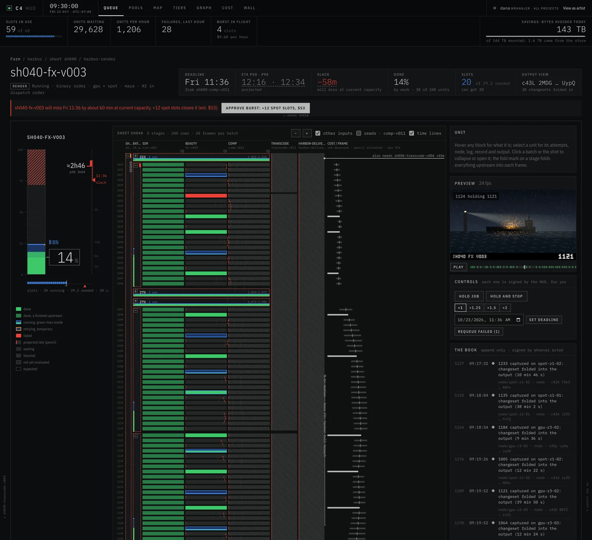

# C4: the render farm that runs by deadline

[](https://github.com/Avalanche-io/c4-operator/releases)
[](https://github.com/Avalanche-io/c4-operator/actions/workflows/ci.yaml)
[](LICENSE)

C4 runs rendering, CI, machine learning and AI agents as one farm, on the
Kubernetes you already have or on a laptop. It is built for media production
first. Work is scheduled by deadline, not by hand-set priority. Every file is
named by what's in it, so each one leaves storage about once, however many
machines read it. Every output is a version, and every step is signed by
whoever did it.



## Why C4

- **Deadlines, not priorities.** You say when a job is due, and the farm works
  out the order. Nobody re-ranks priority numbers when a delivery slips. In a
  five-week simulation, deadline ordering missed about 44% fewer render
  deadlines than manual priorities.
- **Data moves once.** Every file has a C4 ID (SMPTE ST 2114), so the farm
  knows it already has something before it copies it. Machines no longer each
  fetch their own copy: 64 render pods reading one shot cost the store 42
  reads, against 1,792 when each pod fetches for itself.
- **Every output is a version, every step is signed.** A frame traces back to
  the render that made it, the files it read and the model it used, without
  anyone keeping a spreadsheet.
- **Only what needs you comes first.** The HUD puts the one question or
  decision that needs a person on top, and lets the farm handle the rest. No
  more watching a queue.
- **Agents are first-class work.** Claude Code sessions run on the farm like
  any other job, checkpointed at every turn, with the same controls as people
  through MCP.
- **Runs where you are.** On a laptop in Docker, or on your studio's
  Kubernetes cluster, with the same commands.

## Quickstart: render a shot by its deadline

You need Docker (Docker Desktop, OrbStack or Colima). Kind and kubectl are
not needed; kind is built in.

```sh
brew install mrjoshuak/tap/c4
c4 farm up
```

`up` makes a whole farm on your machine: render nodes, a store, the HUD and a
sign-in for you. It takes about a minute and a half.

```sh
c4 farm samples get
cd ~/c4-samples/saltmarsh
c4 farm submit render sm0140/sm0140.usda --frames 1001-1024 --set width=960
```

This fetches a sample shot (79 MB) and renders 24 frames of it with Cycles.
The plan shows the files it uploads, the estimate and the deadline.

```sh
c4 farm open sm0140-light-v001
```

The HUD opens in your browser, signed in. The frames fill in coarse to fine
(first, last, middle, then the quarters), so the whole shot plays early.

```sh
c4 farm deadline sm0140-light-v001 +45m
```

The farm re-plans around the new deadline. There is no priority to set.

```sh
c4 farm get sm0140-light-v001 render ~/renders/sm0140
```

The frames come home, every file checked against its C4 ID. The whole run
takes about five minutes.

[docs/quickstart.md](docs/quickstart.md) goes further: a tool of your own,
provenance, and agents.

## How it works

C4 is a Kubernetes operator. Its custom resources describe jobs, projects,
pools and views, where a view is a directory tree whose files are named by
their C4 IDs. A CSI driver mounts exactly the view a job needs, and a cache
tier of node, peer and regional caches reads each object from storage about
once. A queue releases work in the order its deadlines need, and estimates
when each job will finish. The HUD shows the farm, and an MCP server gives
agents the same controls. [docs/architecture.md](docs/architecture.md) has the
details.

## Other kinds of work

- **Agents:** `c4 farm agents` shows the Claude Code sessions on your machine
  and which one needs you. Running agents as farm jobs:
  [docs/agents/c4-agent.md](docs/agents/c4-agent.md).
- **CI:** `c4 farm submit ci .` runs a Python or Go repository's tests in
  shards. Results caching across commits is coming.
- **Machine learning:** training that yields its GPUs at a checkpoint, and
  inference over every frame. First-job guides are coming.

## Documentation

| document                                           | what it covers                                        |
| -------------------------------------------------- | ----------------------------------------------------- |
| [docs/quickstart.md](docs/quickstart.md)           | a farm on your machine, a render, and your first tool |
| [docs/install.md](docs/install.md)                 | installing on your own Kubernetes cluster             |
| [docs/architecture.md](docs/architecture.md)       | how it works, the commands and the code layout        |
| [docs/results.md](docs/results.md)                 | what the end-to-end suite measured                    |
| [docs/agents/c4-agent.md](docs/agents/c4-agent.md) | agent work on the farm                                |
| [docs/agents/tools.md](docs/agents/tools.md)       | the MCP tools                                         |
| [DESIGN.md](DESIGN.md)                             | the full design                                       |

## Community

- [CONTRIBUTING.md](CONTRIBUTING.md): how to build, test and land a change.
- [Projects you could take on](docs/projects.md): self-contained work with a
  clear contract, from renderer tool kits to tracker adapters.
- [SECURITY.md](SECURITY.md): reporting a security problem privately.

C4 IDs are SMPTE ST 2114, authored by Joshua Kolden and public since 2015.
This is the major release of a design that goes back to 2011.
C4 is short for The Cinema Content Creation Cloud ([cccc.io](https://cccc.io)).

**Status:** v0.2, API `c4.avalanche.io/v1alpha1`.

## License

Apache License 2.0. See [LICENSE](LICENSE) and [NOTICE](NOTICE).
