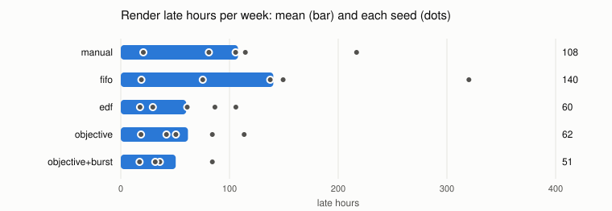
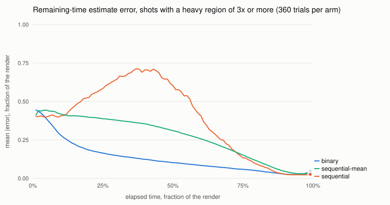

# Work scheduling simulation

Reproduce with `go run ./hack/sim` from the repository root (seeds 1, 2, 3, 4, 5; 40 binary-order trials per cell). Built with go1.26.7. Every number below is produced by that command; nothing is edited by hand except the discussion at the end, which is kept in `hack/sim/discussion.md`.

The simulator calls the production policy code (`internal/work/sched.Decide`) and the estimator (`internal/work/estimate`) on snapshots it builds, as the controller will. Baselines are in the same package with the same signature.

## Results

Mean ± standard deviation across seeds. A render deadline is missed when the job finishes after it; late hours sum the lateness of missed jobs. CI time to green runs from submission to the last shard passing. Utilization is busy slot time over owned capacity for the week (Monday 00:00 to Monday 00:00), including work later lost. Useful GPU hours are GPU time whose work was kept (finished units, and ML progress saved in a checkpoint); lost GPU hours are GPU time thrown away by failures and preemptions, plus ML restore time.

| policy          | render deadlines missed | missed %   | late hours    | CI p50 min | CI p95 min | CI over 15 min % | util cpu % | util gpu % | util ci %  | useful GPU h | lost GPU h | burst $   |
| --------------- | ----------------------- | ---------- | ------------- | ---------- | ---------- | ---------------- | ---------- | ---------- | ---------- | ------------ | ---------- | --------- |
| manual          | 43.0 ± 20.5             | 13.9 ± 6.1 | 107.8 ± 71.2  | 8.9 ± 0.1  | 17.3 ± 1.3 | 9.0 ± 1.3        | 47.2 ± 6.1 | 36.4 ± 6.3 | 17.3 ± 0.3 | 1935 ± 332   | 20.1 ± 5.3 | 0 ± 0     |
| fifo            | 46.6 ± 25.0             | 15.0 ± 7.7 | 140.3 ± 113.3 | 8.9 ± 0.1  | 17.1 ± 1.2 | 8.9 ± 1.3        | 47.1 ± 6.1 | 36.3 ± 6.2 | 17.3 ± 0.3 | 1935 ± 332   | 18.0 ± 4.9 | 0 ± 0     |
| edf             | 24.4 ± 8.8              | 7.9 ± 2.5  | 60.1 ± 37.2   | 8.9 ± 0.1  | 17.2 ± 1.3 | 9.1 ± 1.4        | 47.1 ± 6.1 | 36.3 ± 6.2 | 17.3 ± 0.3 | 1935 ± 332   | 18.0 ± 4.9 | 0 ± 0     |
| objective       | 24.4 ± 10.6             | 7.9 ± 3.2  | 61.0 ± 37.1   | 8.7 ± 0.1  | 14.4 ± 0.5 | 4.2 ± 0.8        | 47.2 ± 6.1 | 36.5 ± 6.3 | 17.3 ± 0.3 | 1935 ± 332   | 28.0 ± 9.7 | 0 ± 0     |
| objective+burst | 22.2 ± 10.6             | 7.2 ± 3.2  | 53.7 ± 35.4   | 8.7 ± 0.1  | 14.4 ± 0.5 | 4.2 ± 0.8        | 45.8 ± 6.1 | 34.5 ± 3.1 | 17.3 ± 0.3 | 1935 ± 332   | 28.4 ± 9.6 | 452 ± 285 |

Render jobs with deadlines per week: 305 on average. The spread across seeds is large because each seed is a different week (job counts, shot lengths, where heavy shots land); compare policies within a seed, below.



### Paired against EDF, same seed

Difference from EDF on the same week (policy minus EDF): mean ± standard deviation of the per-seed difference, and on how many seeds the policy had fewer, equal or more late hours.

| policy                           | Δ missed    | Δ late hours | Δ CI p95 min | seeds with fewer / equal / more late hours |
| -------------------------------- | ----------- | ------------ | ------------ | ------------------------------------------ |
| manual                           | 18.6 ± 13.1 | 47.6 ± 47.4  | 0.1 ± 0.1    | 0 / 0 / 5                                  |
| fifo                             | 22.2 ± 18.4 | 80.1 ± 86.1  | -0.1 ± 0.1   | 0 / 0 / 5                                  |
| objective                        | 0.0 ± 6.0   | 0.8 ± 7.0    | -2.8 ± 1.3   | 1 / 0 / 4                                  |
| objective+burst                  | -2.2 ± 7.3  | -6.4 ± 14.2  | -2.8 ± 1.2   | 3 / 0 / 2                                  |
| objective, no information tier   | -0.4 ± 5.7  | 1.1 ± 8.0    | -1.6 ± 1.0   | 2 / 0 / 3                                  |
| objective, fair-share surplus    | 0.4 ± 4.9   | 2.7 ± 12.4   | -2.7 ± 1.2   | 3 / 0 / 2                                  |
| objective, DESIGN 9.9 as written | 14.0 ± 14.0 | 17.3 ± 27.0  | 0.1 ± 1.7    | 1 / 0 / 4                                  |

### By job kind

Missed deadlines and late hours per kind. ML runs carry a deadline of submission plus 36 hours.

| policy                           | dailies missed     | dailies late h | preview missed     | preview late h | delivery missed | delivery late h | ML missed       | ML late h |
| -------------------------------- | ------------------ | -------------- | ------------------ | -------------- | --------------- | --------------- | --------------- | --------- |
| manual                           | 16.6 ± 10.5 of 106 | 74.2 ± 59.3    | 26.0 ± 14.0 of 186 | 32.7 ± 18.3    | 0.4 ± 0.5 of 13 | 0.9 ± 1.7       | 0.0 ± 0.0 of 22 | 0.0 ± 0.0 |
| fifo                             | 12.6 ± 7.8 of 106  | 53.1 ± 34.7    | 33.8 ± 20.0 of 186 | 85.6 ± 79.8    | 0.2 ± 0.4 of 13 | 1.6 ± 3.6       | 0.0 ± 0.0 of 22 | 0.0 ± 0.0 |
| edf                              | 8.6 ± 5.1 of 106   | 34.0 ± 25.4    | 14.8 ± 4.0 of 186  | 19.6 ± 8.9     | 1.0 ± 1.0 of 13 | 6.6 ± 6.4       | 0.0 ± 0.0 of 22 | 0.0 ± 0.0 |
| objective                        | 8.2 ± 3.6 of 106   | 34.5 ± 25.5    | 15.0 ± 6.1 of 186  | 21.5 ± 11.8    | 1.2 ± 1.3 of 13 | 5.0 ± 5.4       | 0.0 ± 0.0 of 22 | 0.0 ± 0.0 |
| objective+burst                  | 6.4 ± 3.4 of 106   | 27.8 ± 21.9    | 14.8 ± 6.3 of 186  | 21.0 ± 12.0    | 1.0 ± 1.0 of 13 | 4.9 ± 5.0       | 0.0 ± 0.0 of 22 | 0.0 ± 0.0 |
| objective, no information tier   | 8.4 ± 4.3 of 106   | 35.0 ± 25.0    | 14.4 ± 5.3 of 186  | 20.8 ± 11.2    | 1.2 ± 1.3 of 13 | 5.5 ± 5.4       | 0.0 ± 0.0 of 22 | 0.0 ± 0.0 |
| objective, fair-share surplus    | 8.6 ± 3.9 of 106   | 36.0 ± 27.3    | 15.2 ± 5.4 of 186  | 22.3 ± 12.9    | 1.0 ± 1.0 of 13 | 4.5 ± 4.6       | 0.0 ± 0.0 of 22 | 0.0 ± 0.0 |
| objective, DESIGN 9.9 as written | 18.4 ± 13.5 of 106 | 49.4 ± 43.4    | 19.0 ± 8.7 of 186  | 24.1 ± 14.2    | 1.0 ± 1.0 of 13 | 4.0 ± 4.4       | 0.0 ± 0.0 of 22 | 0.0 ± 0.0 |

### By show

Late hours of each show's render jobs (fairness across projects).

| policy                           | showA late h | showB late h | showC late h |
| -------------------------------- | ------------ | ------------ | ------------ |
| manual                           | 27.5 ± 18.8  | 44.9 ± 35.4  | 35.4 ± 32.4  |
| fifo                             | 62.3 ± 48.3  | 47.2 ± 35.7  | 30.9 ± 34.2  |
| edf                              | 23.0 ± 17.8  | 26.4 ± 18.5  | 10.7 ± 10.5  |
| objective                        | 24.5 ± 19.6  | 22.4 ± 18.5  | 14.1 ± 13.9  |
| objective+burst                  | 20.3 ± 20.9  | 21.9 ± 18.0  | 11.6 ± 9.5   |
| objective, no information tier   | 24.9 ± 19.2  | 22.5 ± 18.7  | 13.9 ± 13.9  |
| objective, fair-share surplus    | 23.5 ± 18.5  | 24.3 ± 22.3  | 15.0 ± 14.6  |
| objective, DESIGN 9.9 as written | 30.8 ± 21.5  | 27.6 ± 27.2  | 19.0 ± 19.9  |

### Preemption, lost work and burst

Preemptions counts units stopped (yields and kills). Lost CPU hours include task failures, which every policy suffers alike (failures are drawn per unit and attempt from the seed, not from the policy). Bursts needing approval counts distinct jobs for which the policy found a burst that would restore the deadline but was over the project's budget or cost more than the lateness it prevents; the simulation never approves those.

| policy                           | preemptions | by reason (mean)                              | lost CPU h | ML useful GPU h | ML lost GPU h | burst slot-hours | burst $   | bursts needing approval |
| -------------------------------- | ----------- | --------------------------------------------- | ---------- | --------------- | ------------- | ---------------- | --------- | ----------------------- |
| manual                           | 7 ± 1       | wrangler-suspend 7                            | 198 ± 37   | 378 ± 95        | 2.3 ± 0.9     | 0 ± 0            | 0 ± 0     | 0.0 ± 0.0               |
| fifo                             | 0 ± 0       | none                                          | 184 ± 22   | 378 ± 95        | 0.4 ± 0.4     | 0 ± 0            | 0 ± 0     | 0.0 ± 0.0               |
| edf                              | 0 ± 0       | none                                          | 184 ± 22   | 378 ± 95        | 0.4 ± 0.4     | 0 ± 0            | 0 ± 0     | 0.0 ± 0.0               |
| objective                        | 1176 ± 441  | reclaim-nominal 304, restore-feasibility 871  | 223 ± 34   | 378 ± 95        | 0.4 ± 0.4     | 0 ± 0            | 0 ± 0     | 4.2 ± 2.0               |
| objective+burst                  | 1180 ± 484  | reclaim-nominal 316, restore-feasibility 864  | 220 ± 32   | 378 ± 95        | 0.4 ± 0.4     | 709 ± 421        | 452 ± 285 | 1.4 ± 1.7               |
| objective, no information tier   | 1279 ± 463  | reclaim-nominal 320, restore-feasibility 960  | 225 ± 33   | 378 ± 95        | 0.4 ± 0.4     | 0 ± 0            | 0 ± 0     | 4.0 ± 1.4               |
| objective, fair-share surplus    | 1122 ± 391  | reclaim-nominal 262, restore-feasibility 860  | 222 ± 34   | 378 ± 95        | 0.4 ± 0.5     | 0 ± 0            | 0 ± 0     | 5.2 ± 1.3               |
| objective, DESIGN 9.9 as written | 1256 ± 588  | reclaim-nominal 227, restore-feasibility 1029 | 232 ± 50   | 378 ± 95        | 0.9 ± 1.1     | 0 ± 0            | 0 ± 0     | 56.4 ± 32.9             |

### Ablations

The objective policy with parts of DESIGN.md section 9.9 restored as written (see the discussion for what changed and why). Same columns as the main table.

| policy                           | render deadlines missed | missed %   | late hours  | CI p50 min | CI p95 min | CI over 15 min % | util cpu % | util gpu % | util ci %  | useful GPU h | lost GPU h  | burst $ |
| -------------------------------- | ----------------------- | ---------- | ----------- | ---------- | ---------- | ---------------- | ---------- | ---------- | ---------- | ------------ | ----------- | ------- |
| objective                        | 24.4 ± 10.6             | 7.9 ± 3.2  | 61.0 ± 37.1 | 8.7 ± 0.1  | 14.4 ± 0.5 | 4.2 ± 0.8        | 47.2 ± 6.1 | 36.5 ± 6.3 | 17.3 ± 0.3 | 1935 ± 332   | 28.0 ± 9.7  | 0 ± 0   |
| objective, no information tier   | 24.0 ± 10.5             | 7.8 ± 3.1  | 61.3 ± 37.0 | 8.8 ± 0.1  | 15.6 ± 0.6 | 5.8 ± 0.9        | 47.2 ± 6.1 | 36.5 ± 6.3 | 17.3 ± 0.3 | 1935 ± 332   | 27.5 ± 8.7  | 0 ± 0   |
| objective, fair-share surplus    | 24.8 ± 9.9              | 8.0 ± 2.9  | 62.8 ± 41.1 | 8.8 ± 0.1  | 14.4 ± 0.6 | 4.0 ± 0.9        | 47.2 ± 6.1 | 36.5 ± 6.3 | 17.3 ± 0.3 | 1935 ± 332   | 26.9 ± 8.6  | 0 ± 0   |
| objective, DESIGN 9.9 as written | 38.4 ± 21.3             | 12.4 ± 6.2 | 77.4 ± 56.2 | 8.8 ± 0.1  | 17.2 ± 1.1 | 9.0 ± 1.9        | 47.3 ± 6.1 | 36.6 ± 6.4 | 17.3 ± 0.3 | 1935 ± 332   | 29.9 ± 13.9 | 0 ± 0   |

## Sensitivity: half the GPUs

The main farm's GPU pool runs at about a third of capacity, so ML runs and GPU renders rarely contend there. This scenario replays the same weeks (same seeds, same jobs) with 16 owned GPUs instead of 32 and every GPU quota halved. Everything else is unchanged.

| policy          | render missed | render late h | GPU render missed | GPU render late h | ML missed | util gpu %  | ML useful GPU h | ML lost GPU h | lost GPU h  | preemptions | burst $   |
| --------------- | ------------- | ------------- | ----------------- | ----------------- | --------- | ----------- | --------------- | ------------- | ----------- | ----------- | --------- |
| manual          | 68.8 ± 23.7   | 476.3 ± 596.1 | 28.6 ± 23.7       | 375.5 ± 621.8     | 5.4 ± 7.9 | 72.7 ± 12.3 | 378 ± 95        | 3.8 ± 2.7     | 21.8 ± 3.7  | 10 ± 6      | 0 ± 0     |
| fifo            | 82.0 ± 30.0   | 610.0 ± 645.9 | 39.8 ± 15.9       | 480.0 ± 694.0     | 2.2 ± 4.9 | 72.6 ± 12.3 | 378 ± 95        | 0.4 ± 0.4     | 18.0 ± 4.9  | 0 ± 0       | 0 ± 0     |
| edf             | 49.2 ± 18.8   | 381.6 ± 574.9 | 27.6 ± 19.9       | 328.5 ± 591.0     | 4.4 ± 8.8 | 72.6 ± 12.3 | 378 ± 95        | 0.4 ± 0.4     | 18.0 ± 4.9  | 0 ± 0       | 0 ± 0     |
| objective       | 47.4 ± 23.8   | 532.7 ± 563.1 | 24.6 ± 16.7       | 476.3 ± 540.0     | 0.4 ± 0.9 | 73.2 ± 11.9 | 378 ± 95        | 4.3 ± 1.2     | 47.2 ± 11.3 | 1839 ± 698  | 0 ± 0     |
| objective+burst | 23.2 ± 9.3    | 54.6 ± 32.5   | 1.4 ± 1.7         | 2.6 ± 4.8         | 0.0 ± 0.0 | 50.3 ± 5.8  | 378 ± 95        | 3.8 ± 1.0     | 46.5 ± 10.4 | 1539 ± 433  | 919 ± 374 |

## Binary against sequential order

One shot at a time on 16 slots, rendered in binary or in sequential order: 40 trials for each frame count [120 240 480] and each heavy-region multiplier [1 2 3 5 8] (1 is the control, with no heavy region). At 99 evenly spaced moments of the render the estimated remaining time, max(W/P, t_path), is compared with the truth. The `sequential-mean` arm uses the usual render-manager estimate (mean of completed frames times frames left) instead of the estimate package.

### Error of the remaining-time estimate

Mean of |estimated - true| / true remaining time, over all frame counts, at the given fraction of the render's elapsed time; then the mean over the whole render and the mean signed error (negative: underestimate).

| multiplier | arm             | at 10% | at 25% | at 50% | at 75% | whole render | signed |
| ---------- | --------------- | ------ | ------ | ------ | ------ | ------------ | ------ |
| 1x         | binary          | 0.083  | 0.064  | 0.097  | 0.186  | 0.150        | -0.078 |
| 1x         | sequential      | 0.135  | 0.155  | 0.177  | 0.225  | 0.211        | -0.084 |
| 1x         | sequential-mean | 0.181  | 0.118  | 0.135  | 0.212  | 0.187        | -0.098 |
| 2x         | binary          | 0.112  | 0.103  | 0.144  | 0.186  | 0.196        | -0.101 |
| 2x         | sequential      | 0.234  | 0.365  | 0.385  | 0.235  | 0.317        | -0.004 |
| 2x         | sequential-mean | 0.255  | 0.258  | 0.278  | 0.206  | 0.262        | -0.044 |
| 3x         | binary          | 0.185  | 0.135  | 0.190  | 0.213  | 0.244        | -0.111 |
| 3x         | sequential      | 0.338  | 0.511  | 0.672  | 0.328  | 0.464        | +0.046 |
| 3x         | sequential-mean | 0.340  | 0.361  | 0.418  | 0.360  | 0.383        | -0.044 |
| 5x         | binary          | 0.308  | 0.220  | 0.220  | 0.253  | 0.330        | -0.124 |
| 5x         | sequential      | 0.443  | 0.939  | 1.239  | 0.465  | 0.784        | +0.340 |
| 5x         | sequential-mean | 0.462  | 0.527  | 0.734  | 0.659  | 0.640        | +0.118 |
| 8x         | binary          | 0.441  | 0.303  | 0.205  | 0.238  | 0.390        | -0.114 |
| 8x         | sequential      | 0.574  | 0.887  | 1.707  | 0.801  | 1.063        | +0.542 |
| 8x         | sequential-mean | 0.591  | 0.663  | 0.713  | 0.794  | 0.777        | +0.061 |

Relative error grows near the end of every render because the true remainder approaches zero; the chart therefore shows the absolute error as a fraction of the render, averaged over trials with a heavy region of 3x or more.



### Heavy region flagged, and slack settled

A heavy region is flagged when the estimator reports a run of frames above 3x the reference cost that overlaps the true region (a running frame counts once its elapsed time alone is above the threshold). Times are fractions of the render. False flags are trials in which a region not overlapping the true one was flagged at some moment. The deadline is set so the true slack is 50% of the render; the slack estimate is within the band when its error is at most 10% of the true slack, and has settled when it stays in the band from then on (trials that never settle count as 1.00).

| multiplier | arm             | heavy region flagged | false flags | slack within band, share of render | slack settled, median | slack settled, p90 | settled before the end |
| ---------- | --------------- | -------------------- | ----------- | ---------------------------------- | --------------------- | ------------------ | ---------------------- |
| 1x         | binary          | n/a                  | 0%          | 65%                                | 0.52                  | 0.87               | 98%                    |
| 1x         | sequential      | n/a                  | 6%          | 42%                                | 0.84                  | 0.91               | 100%                   |
| 1x         | sequential-mean | n/a                  | n/a         | 46%                                | 0.79                  | 0.89               | 100%                   |
| 2x         | binary          | 54%, median at 0.34  | 0%          | 52%                                | 0.76                  | 1.00               | 88%                    |
| 2x         | sequential      | 76%, median at 0.50  | 3%          | 33%                                | 0.85                  | 0.91               | 98%                    |
| 2x         | sequential-mean | n/a                  | n/a         | 36%                                | 0.74                  | 0.86               | 98%                    |
| 3x         | binary          | 100%, median at 0.15 | 0%          | 39%                                | 0.82                  | 1.00               | 73%                    |
| 3x         | sequential      | 100%, median at 0.46 | 3%          | 28%                                | 0.85                  | 0.92               | 93%                    |
| 3x         | sequential-mean | n/a                  | n/a         | 26%                                | 0.83                  | 0.95               | 92%                    |
| 5x         | binary          | 100%, median at 0.11 | 0%          | 28%                                | 0.85                  | 1.00               | 66%                    |
| 5x         | sequential      | 100%, median at 0.35 | 0%          | 26%                                | 0.86                  | 1.00               | 82%                    |
| 5x         | sequential-mean | n/a                  | n/a         | 17%                                | 0.92                  | 1.00               | 79%                    |
| 8x         | binary          | 100%, median at 0.08 | 0%          | 25%                                | 0.96                  | 1.00               | 54%                    |
| 8x         | sequential      | 100%, median at 0.30 | 0%          | 20%                                | 0.90                  | 1.00               | 68%                    |
| 8x         | sequential-mean | n/a                  | n/a         | 13%                                | 0.96                  | 1.00               | 64%                    |

### Makespan

The order also changes when the shot finishes on a fixed number of slots. Binary order leaves frames from every part of the shot, heavy ones included, to its last levels, so the last wave can hold long frames that start late; sequential order finishes with whatever lies at the end of the shot. Ratio of binary to sequential makespan for the same shot.

| multiplier | mean ratio | median | p90   | binary more than 5% longer |
| ---------- | ---------- | ------ | ----- | -------------------------- |
| 1x         | 1.002      | 1.002  | 1.021 | 2%                         |
| 2x         | 1.037      | 1.026  | 1.100 | 24%                        |
| 3x         | 1.064      | 1.053  | 1.156 | 54%                        |
| 5x         | 1.114      | 1.083  | 1.231 | 77%                        |
| 8x         | 1.134      | 1.123  | 1.244 | 81%                        |

### Calibration of W90

Share of moments at which the true remaining work was at or below the estimator's W90. A calibrated 90th percentile would cover about 90%.

| multiplier | binary | sequential |
| ---------- | ------ | ---------- |
| 1x         | 88%    | 90%        |
| 2x         | 85%    | 83%        |
| 3x         | 83%    | 72%        |
| 5x         | 71%    | 70%        |
| 8x         | 68%    | 65%        |

## Every parameter

### Farm

| pool     | slots    | kind  | provisioning | per slot-hour |
| -------- | -------- | ----- | ------------ | ------------- |
| cpu      | 240      | owned |              |               |
| gpu      | 32       | owned |              |               |
| ci       | 32       | owned |              |               |
| cpu-spot | 0 to 160 | burst | 7m0s         | $0.60         |
| cpu-od   | 0 to 80  | burst | 4m0s         | $1.43         |
| gpu-spot | 0 to 24  | burst | 8m0s         | $0.80         |
| gpu-od   | 0 to 16  | burst | 5m0s         | $1.86         |

A CPU slot is a 32 vCPU render node; a GPU slot is one 48 GB class GPU; a CI slot is an 8 vCPU runner. Burst prices are approximate public list prices for comparable instances (c7i.8xlarge, one GPU of a g6e.xlarge), spot at about 40 to 45 percent of on-demand, not quoted from a live price list. Provisioning includes boot, image pull and C4 cache pre-warm. Spot interruptions are not modeled. Render jobs may use their pool type's owned and burst pools; CI uses only the CI pool; ML runs use only the owned GPU pool. The baselines see the burst pools but never request them.

| project | nominal quota (borrowing unlimited) | burst budget per day | lateness cost per hour | manual priority bonus |
| ------- | ----------------------------------- | -------------------- | ---------------------- | --------------------- |
| showA   | cpu 110, gpu 8                      | $2000                | $600                   | 4                     |
| showB   | cpu 80, gpu 6                       | $1200                | $450                   | 2                     |
| showC   | cpu 50, gpu 4                       | $800                 | $300                   | 0                     |
| rnd     | gpu 14                              | $0                   | $0                     | 0                     |
| eng     | ci 32                               | $0                   | $0                     | 0                     |

Manual baseline priorities by job type: ci 90, dailies 60, delivery 70, ml 30, preview 50, plus the show bonus. Quotas apply only to the objective policy; the baselines have none.

### Workload

```
Days: 7
DailiesPerEvening: map[showA:9 showB:7 showC:5]
DailiesSubmitMean: 19
DailiesSubmitSD: 1.3
DailiesSubmitLo: 15
DailiesSubmitHi: 23.5
PreviewPerHour: map[showA:2 showB:1.5 showC:1]
PreviewCost: 0.35
PreviewTurn: 3
DeliveriesPerShow: map[showA:6 showB:4 showC:3]
DeliveryCost: 1.6
DeliveryFrames: 150
FramesMedian: 100
FramesSigma: 0.5
FramesMin: 24
FramesMax: 400
CPUFrameMin: 45
GPUFrameMin: 12
JobSigma: 0.6
FrameSigma: 0.2
TrendAmp: 0.15
HeavyProb: 0.4
HeavyLenLo: 0.08
HeavyLenHi: 0.25
HeavyMults: [2 3 5 8]
GPUShare: 0.25
DeliveryGPUShare: 0.2
ExpandShare: 0.3
DeliveryExpandShare: 0.4
EnvCost: 0.2
VolumesCost: 0.3
PassSigma: 0.1
VolumesProbLo: 0.3
VolumesProbHi: 0.9
UsdExportSec: 45
UsdExportSigma: 0.3
RenderFailProb: 0.02
CIRatePerHour: 30
CIBuildMin: 3
CIBuildSigma: 0.3
CIShardsBase: 4
CIShardsPoisson: 10
CITargets: 400
CITargetMin: 1.5
CITargetSigma: 0.6
CIRunSigma: 0.15
CIFailProb: 0.02
CISLO: 15
CIMergeDayFactor: 1.3
MLWeekdayRuns: 4
MLWeekendRuns: 2
MLGPUs: [1 2 4 8]
MLGPUWeights: [0.2 0.35 0.35 0.1]
MLHoursMedian: 5
MLHoursSigma: 0.5
MLCkptMinLo: 5
MLCkptMinHi: 15
MLRestoreMin: 3
MLHazardPerHour: 0.005
MLDeadlineHours: 36
MLDeclaredSigma: 0.15
```

Render jobs whose frames are generators export the frame's USD stage (a Solaris USD export, 45 s median, on the job's pool) and expand into a deep environment layer (0.2x the frame's cost), a deep volumes layer with a per-job probability (0.3x), and a beauty layer that holds out against both, so it depends on both. CI pipelines are a build that discovers 4 + Poisson(10) shards from a fixed monorepo of 400 test targets, each with its own duration and failure rate; shards run in order of failure rate. Failures happen per attempt (render and CI 2%, the fourth attempt always succeeds; ML runs at 0.5% per hour of progress) and are drawn from the seed and the unit, so every policy sees the same failures. ML runs checkpoint at a per-run interval; a yield waits for the next checkpoint and loses only restore time, a kill loses the work since the last checkpoint.

The estimator's history priors are built from 2,400 render jobs and 3,000 CI pipelines drawn from the same generator with a seed no experiment uses, so they describe the population a job comes from, not the job. An ML run's prior is its declared length (steps times historical step time), off by a lognormal factor with sigma 0.15.

### Policy settings

```
StarvationAfter: 30m0s
TieBand: 0.1
InfoUnitsPerJob: 0
PreemptSlack: 2h0m0s
PreemptWindow: 10m0s
PreemptPerWindow: 8
MaxPreemptionsPerUnit: 2
MaxLostWork: 15m0s
ScaleDownAfter: 10m0s
Burst: true
MinRemaining: 5m0s
TailAware: true
Planner: fluid-edf
NoInfoTier: false
Surplus: least-slack
SlackBand: 1h0m0s
RateSlack: 24h0m0s
WranglerEvery: 2h0m0s
WranglerMargin: 1h0m0s
WranglerUnbump: 3h0m0s
WranglerStartAlarm: 4h0m0s
```

Simulation: a decision at most every 10 s after a change and at least every 60 s; a job's estimate is refreshed on change or every 300 s while it runs. The Manual wrangler reviews every 2 hours.

### Binary-order experiment

```
Frames: [120 240 480]
Mults: [1 2 3 5 8]
Slots: 16
BaseMin: 20
JobSigma: 0.4
FrameSigma: 0.2
TrendAmp: 0.15
HeavyLenLo: 0.08
HeavyLenHi: 0.25
Trials: 40
SlackFrac: 0.5
SettleFrac: 0.1
GridPoints: 99
Seed: 45477
HeavyFactor: 3
PriorSamples: 20000
```

## Discussion

### Summary

- On render deadlines the objective policy without burst ties EDF: per seed, 0.0 ± 6.0 more missed deadlines and 0.8 ± 7.0 more late hours, with fewer late hours than EDF on 1 of 5 seeds. It does not beat EDF there. Both are far ahead of FIFO and of the Manual baseline (about 19 to 22 fewer missed deadlines a week).
- With burst, the objective policy has fewer late hours than EDF on 4 of 5 seeds (8.4 ± 14.7 fewer per week) for $578 ± 262 a week of cloud capacity. At the projects' lateness prices ($300 to $600 an hour) the hours saved are worth several times the spend, but the per-seed spread is wide.
- CI is where the policy helps without spending: p95 time to green falls from 17.2 to 14.4 minutes, and pipelines over the 15-minute SLO from 9.1% to 4.2%. Turning the information tier off (builds that discover shards are released ahead of other pipelines' spare shards) gives back about half of the p95 gain and a third of the SLO gain (15.9 minutes, 6.0%).
- DESIGN.md section 9.9 as written does clearly worse than EDF: 14.0 ± 14.0 more missed deadlines a week. The policy that was measured differs from it in the ways listed below, each one found by tracing a specific late job in this simulator. DESIGN.md has not been updated to match; it should be.
- When GPUs are scarce (the half-GPU scenario), the objective policy meets ML deadlines that EDF and Manual miss (0.4 against 4.4 and 5.4 a week) by having training runs yield at checkpoints, but without burst its render late hours are higher than EDF's (533 against 382). With burst it cuts GPU render late hours from 476 to 2.3 a week for about $1,110.
- Binary order flags heavy regions much earlier than sequential order (median at 8 to 15 percent of the render against 30 to 46 percent) and keeps the remaining-time error lower for most of the render. It costs makespan when shots have heavy regions (6 to 13 percent longer on average at 3x to 8x), and its slack estimate settles near the end of the render later than sequential order's.

### How the measured policy differs from DESIGN.md 9.9, and why

1. **Required slots are planned per pool group, not per job.** DESIGN.md sets R = W90/T for each job on its own. That treats every job as if the farm's future were its alone. On Wednesday night of seed 1 the Friday deliveries each claimed a steady share of the farm while that night's dailies needed all of it, and because no single job looked infeasible against the whole pool, the overload rule never fired: water-filling by running/R spread the shortage over every job and all of them finished slightly late. The measured policy plans each group of pools as one earliest-deadline-first fluid schedule, uses Moore-Hodgson to pick the set of jobs that can all be on time (the classic algorithm that minimizes the number of late jobs, which is what the overload rule asks for), and sets each job's R to what that schedule gives it now. A job due on Friday gets R = 0 on Wednesday night if it is on time after the dailies finish. The ablation "DESIGN 9.9 as written" keeps the per-job rule.
2. **R leaves room for the last wave.** With R = W90/T a job holding exactly R slots starts its longest units too late (list scheduling finishes within W/R plus the longest unit). R is computed against T minus the critical path. In seed 1 this alone cut dailies misses from 20 to 9 before the change above.
3. **Spare capacity goes by least planned slack, with fair share as the tiebreaker.** DESIGN.md gives spare capacity to projects by fair share first. The project's requirements say "the jobs most at risk get capacity first, with fair share across projects as the tiebreaker", and that is what was built. The difference is small here (ablation: 1.9 more late hours, within the seed spread).
4. **Quota is held back only for deadline need.** An earlier version reserved a project's unused nominal quota whenever it had runnable work, so a show's Friday deliveries blocked another show's urgent dailies from borrowing. Kueue lends all unused quota and takes it back by preemption; the measured policy holds back only what a project needs now for jobs below their required rate.
5. **Preemption moves allocations toward the plan and never kills more than 15 minutes of work.** Victims must hold more than their planned share, the job gaining slots must hold less than min(R, share), and a unit that would lose more than 15 minutes (time since its last checkpoint plus restore cost) is not a victim. Before these rules, jobs took units back and forth, and on seed 1 the policy lost about 330 CPU hours more than EDF to killed frames. It still preempts about 1,200 units a week; lost CPU hours are 223 against EDF's 184, and lost GPU hours 28 against 18, out of about 1,935 useful GPU hours.
6. **Estimator.** A key with no completed unit in the job now uses history for that key before the job's median over other keys: a beauty pass just revealed by a generator was being predicted from 45-second generator evaluations, putting a 150 slot-hour job at 2 slot-hours. Running units that have run longer than their prediction are entered as censored observations (duration at least elapsed, assumed 1.25 times elapsed, the same overrun rule DESIGN.md uses for a running unit's remainder). Without this, binary order sampled frames inside an 8x region within minutes, but the estimator learned nothing until those 4.6-hour frames finished.

The simulation also caught a nondeterminism bug: summing region errors over a Go map made results differ in the last digit between runs, enough to flip decisions. Two full runs now produce byte-identical CSVs.

### Where a baseline does as well or better, and why

- **EDF on render deadlines.** On this workload the binding constraint is the nightly crunch, where most work shares one deadline (08:00), and earliest deadline first already serves it in the right order. The objective policy adds quotas, preemption and fair-share tie-breaking, which cost a little work and do not change the order much. The by-show table shows no fairness gain from quotas either: EDF's late hours per show are as even as the objective policy's.
- **EDF under GPU overload, on late hours.** Moore-Hodgson minimizes the number of late jobs. When it must drop jobs it drops the largest, and those wait until capacity frees, so the late hours of the few dropped jobs grow. In the half-GPU scenario the objective policy missed 47.4 deadlines against EDF's 49.2 but accumulated 533 late hours against 382. A rule that weighs lateness (hours or cost) rather than count would trade differently; the overload rule in DESIGN.md chooses the count.
- **Lost work.** EDF, FIFO and Manual preempt almost nothing, so they lose only what failures lose.
- **Manual** is a competent wrangler with Deadline-style static priorities: deliveries above dailies above previews. Those priorities put Friday deliveries ahead of the dailies on Wednesday and Thursday nights, and the two-hourly review cannot recover a job that fell behind early in the night. That, not a straw-man rule set, is why it trails EDF.

### Binary order

- **Detection.** Every 3x, 5x and 8x region was flagged in both orders; binary order flagged it at a median of 15, 11 and 8 percent of the render, sequential order at 46, 35 and 30 percent. Binary order produced no false flags; sequential order produced them in up to 6 percent of trials (a one-sided estimate near a heavy edge). At 2x, below the 3x threshold, flags are expected to be rare and are.
- **Error.** Over the whole render the mean relative error of remaining time was 0.15 (binary), 0.21 (sequential with the same estimator) and 0.19 (sequential with the render-manager mean) on shots without a heavy region, and 0.39, 1.06 and 0.78 on 8x shots. The slack estimate was within 10% of the true slack for 65% of the render under binary order against 42% and 46% for the sequential arms on plain shots, and 25% against 20% and 13% on 8x shots.
- **Sequential with the estimator is worse than the plain mean in heavy shots.** Once sequential order enters a heavy region, the estimator's one-sided rule (median of the three nearest frames) assumes the rest of the shot is as heavy as the last frames, which overestimates by 54% on average at 8x. The plain mean dilutes the heavy frames instead. This is a weakness of the one-sided fallback, visible only in sequential order.
- **Makespan.** Binary order leaves frames from everywhere in the shot, heavy ones included, to its finest levels, so the last wave on a fixed slot count can hold long frames that start late. Binary renders were longer than sequential ones by 6%, 11% and 13% on average at 3x, 5x and 8x (no difference on plain shots). Starting the longest known frames of each level first would likely recover most of this; it was not tried.
- **Settling.** For heavy shots the binary estimate settles inside the 10% band later in the render, or not at all before the end, more often than sequential (at 8x: 54% of trials settle before the end against 68%). Near the end, heavy frames still running make the remainder lumpy under binary order, while sequential order has left its heavy region behind.
- **Calibration.** W90 covered the true remaining work 88% of the time on plain shots, close to the intended 90%, but only 68% to 83% on shots with a heavy region of 3x or more. The error bars are too narrow when part of the cost has not been sampled yet.
- Both orders underestimate remaining time by about 8% on plain shots: max(W/P, t_path) leaves out the tail of a list schedule, the same effect item 2 above corrects for in R.

### What the simulation does not show

- The workload is synthetic. Parameters were chosen to look like a mid-size studio, not fitted to a real farm's logs.
- The main scenario's GPU pool runs at about 36% utilization, so ML and GPU rendering seldom contend there; ML lost GPU hours under the objective policy equal EDF's, so no training run yielded in it. The half-GPU scenario is the only evidence for the yield-at-checkpoint behavior, and its late-hour figures are dominated by one or two seeds (the standard deviations exceed the means).
- Spot interruptions, inter-job dependencies (deadline propagation up a dependency graph), pod start-up time and cache warm-up on owned nodes are not modeled. Burst suggestions that need approval are never approved. Quotas apply only to the objective policy.
- Decisions are coalesced to at most one every 10 seconds; the controller design coalesces to one per second.
- Five seeds are few for metrics with this much week-to-week spread. The paired comparisons are the fairer reading.

### Calibration and changes after seeing results

- The CI pool was sized at 24 runners in the initial run. Every policy then had a CI p95 of about 60 minutes, which did not match the intended peak load of about 90%, so the pool was raised to 32. No other workload, farm or baseline parameter was changed after results were seen.
- The objective policy and the estimator were changed after results were seen, as listed above, and each change is in the code with its reason. The ablation rows keep the earlier rules runnable (`sched.Config`: `Planner`, `TailAware`, `Surplus`, `NoInfoTier`), so the effect of the main changes can be checked with the same command.
- The binary-order experiment's parameters were set before it was run and were not changed.
