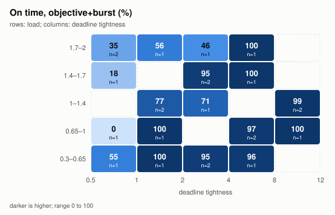
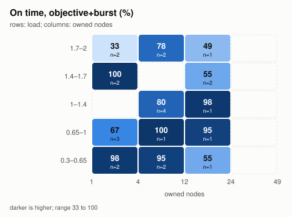
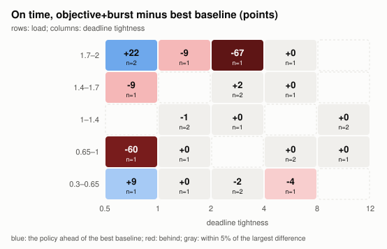
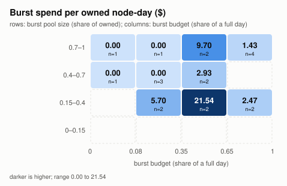
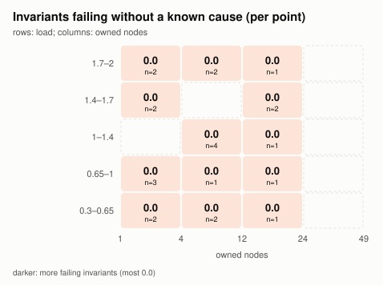
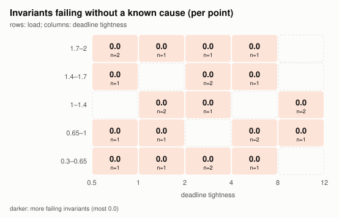

# Scheduler stress grid

`go run ./hack/stress -quick` ran 39 grid points (24 Latin hypercube samples over 34 dimensions, plus 15 corners), 381 runs in all, in 5s with 4 workers. Every run calls the production policy (`sched.Decide`) or a baseline through `sched.Policy` on a simulated farm; the invariants below are checked on every decision of `objective` and `objective+burst`.

0 violations of invariants without a known cause, 0 of known bugs.

Spot capacity by provider (AWS, GCP, Azure), with and without the completion-aware spot policy, is in [spot.md](spot.md).

## Invariants

| Invariant                  | Holds when                                                                                                                                                                                              | Points violating | Status |
| -------------------------- | ------------------------------------------------------------------------------------------------------------------------------------------------------------------------------------------------------- | ---------------- | ------ |
| `starvation`               | a job with ready work and nothing running for 30 minutes gets the next free slot it may use (after the deadline tier if it has more than PreemptSlack of slack, until it has waited StarvationDeferMax) | 0 of 39          | holds  |
| `starvation-over-deadline` | the starvation guard does not give the last free slot of a pool to a job with more than PreemptSlack of slack while a job on time in the plan needs it                                                  | 0 of 39          | holds  |
| `work-conservation`        | no slot is left idle while ready work that may use it waits, unless a gang holds it, a borrowing limit forbids it, or it is held for another project's guaranteed deadline need                         | 0 of 39          | holds  |
| `blocked-rank`             | a job whose units all wait on upstream work is never ranked ahead of a job with ready work                                                                                                              | 0 of 39          | holds  |
| `held-rank`                | a held job (it releases nothing) is never ranked ahead of a job with ready work                                                                                                                         | 0 of 39          | holds  |
| `blocked-dispatch`         | only runnable units are dispatched                                                                                                                                                                      | 0 of 39          | holds  |
| `overfill`                 | no pool is given more units than it has free slots                                                                                                                                                      | 0 of 39          | holds  |
| `hold`                     | a held job gets no units; a hold-stopped job's running units are all stopped                                                                                                                            | 0 of 39          | holds  |
| `borrow-limit`             | no project goes past its nominal quota plus its borrowing limit                                                                                                                                         | 0 of 39          | holds  |
| `boost-quota`              | a boost takes slots only within its own project's quota or from capacity no other project is guaranteed                                                                                                 | 0 of 39          | holds  |
| `lateness-unpriced`        | a job planned late has LateBy > 0, so its lateness has a cost                                                                                                                                           | 0 of 39          | holds  |
| `eta-inconsistent`         | a job at risk has an ETA after its deadline; a job on track has one before it                                                                                                                           | 0 of 39          | holds  |
| `past-due-on-track`        | an unfinished job past its deadline is reported at risk                                                                                                                                                 | 0 of 39          | holds  |
| `burst-uneconomic`         | an automatic burst closes the deadline and costs less than the lateness it prevents                                                                                                                     | 0 of 39          | holds  |
| `burst-budget`             | automatic bursts stay within each project's remaining daily budget                                                                                                                                      | 0 of 39          | holds  |
| `burst-unjustified`        | a burst pool's request grows only by automatically approved slots, and never past its limit                                                                                                             | 0 of 39          | holds  |
| `lend-then-reclaim`        | a pool's free slots are not lent to a borrowing project in the same decision that preempts a borrower to restore another project's nominal quota                                                        | 0 of 39          | holds  |
| `churn-unit`               | a unit is preempted at most MaxPreemptionsPerUnit times                                                                                                                                                 | 0 of 39          | holds  |
| `churn-pool`               | a pool sees at most PreemptPerWindow preemptions per PreemptWindow                                                                                                                                      | 0 of 39          | holds  |
| `churn-pingpong`           | two jobs never trade slots back and forth (two reversals) within an hour                                                                                                                                | 0 of 39          | holds  |
| `determinism`              | the same point and seed give the same decisions                                                                                                                                                         | 0 of 39          | holds  |
| `metamorphic-capacity`     | more owned capacity does not make more jobs late, beyond noise                                                                                                                                          | 0 of 39          | holds  |
| `metamorphic-deadline`     | looser deadlines do not make more jobs late, beyond noise                                                                                                                                               | 0 of 39          | holds  |
| `metamorphic-budget`       | a bigger burst budget does not make more jobs late, beyond noise                                                                                                                                        | 0 of 39          | holds  |
| `decide-latency`           | one decision takes under a second at every farm size in the grid                                                                                                                                        | 0 of 39          | holds  |
| `dispatch-invalid`         | dispatches name a known unit and a pool the job may use                                                                                                                                                 | 0 of 39          | holds  |

The prediction scores (AtRisk against actual lateness) and Decide's cost by farm size are measured, not asserted; see below.

## Findings

No invariant failed.

## Policy against baselines

The same workloads under each policy. `objective` is `sched.Decide` without burst requests, `objective+burst` with them; the baselines never burst. Wins and losses count points where `objective+burst` finished more jobs on time than the baseline, or fewer, by more than 2% of the point's deadline jobs. Baselines ignore quotas, so on points with tight borrowing limits they use capacity the policy is not allowed to lend.

| Policy            | Mean on time | Median on time | Late hours | Lateness cost | Burst spend | Owned use | Preemptions | objective+burst wins / ties / losses |
| ----------------- | ------------ | -------------- | ---------- | ------------- | ----------- | --------- | ----------- | ------------------------------------ |
| `objective+burst` | 74.6%        | 90.6%          | 1276       | $453708       | $1148       | 34%       | 208         | -                                    |
| `objective`       | 68.6%        | 90.3%          | 1724       | $587152       | $0          | 35%       | 203         | 5 / 34 / 0                           |
| `edf`             | 74.2%        | 95.0%          | 1244       | $459716       | $0          | 40%       | 30          | 3 / 33 / 3                           |
| `fifo`            | 67.1%        | 84.6%          | 1914       | $779464       | $0          | 39%       | 23          | 12 / 26 / 1                          |
| `fair-share`      | 69.1%        | 88.5%          | 1633       | $697289       | $0          | 39%       | 21          | 10 / 27 / 2                          |
| `static-priority` | 70.1%        | 83.9%          | 1855       | $884961       | $0          | 39%       | 23          | 10 / 25 / 4                          |

On-time points of `objective+burst` minus the best baseline at each point, mean by region (positive: the policy is ahead):

| Load \ tightness | 0.5-1     | 1-2      | 2-4       | 4-8      | 8-12     |
| ---------------- | --------- | -------- | --------- | -------- | -------- |
| 0.3-0.65         | +9.1 (1)  | +0.0 (1) | -2.5 (2)  | -3.8 (1) |          |
| 0.65-1           | -60.0 (1) | +0.0 (1) |           | +0.0 (2) | +0.0 (1) |
| 1-1.4            |           | +0.0 (2) | +0.0 (1)  |          | +0.0 (2) |
| 1.4-1.7          | -7.3 (1)  |          | +0.0 (2)  | +0.0 (1) |          |
| 1.7-2            | +15.4 (2) | -8.8 (1) | -53.8 (1) | +0.0 (1) |          |

Points where `objective+burst` trails the best baseline by more than 10 points:

- g015 (2 nodes, load 0.96, tight 0.76, dailies): 0.0% on time against 60.0% for `static-priority`. `go run ./hack/stress -point 'nodes=2,gpuFrac=0.125,projects=8,quotaFill=0.491,quotaSkew=0.727,borrow=0.0136,provisioning=24.6,burstCost=0.54,burstBudget=0.699,interruptions=0.102,lateCost=20.6,load=0.965,days=0.342,arrivals=1,tightness=0.763,slackSpread=0.368,noDue=0.0317,unitMin=3.65,spread=0.876,heavy=0.393,heavyMult=4,depth=1,width=1,expand=0.307,estErr=0.37,mlShare=0.136,ranks=4,ckptMin=38.1,failRate=0.0144,nodeFaults=0.436,boostRate=0.0541,holdRate=0.12,drain=0.5' -seed 1`
- g002 (3 nodes, load 1.7, tight 2.8, dailies): 46.2% on time against 100.0% for `edf`. `go run ./hack/stress -point 'nodes=3,projects=3,quotaSkew=1.9,borrow=-0.399,burstFrac=0.352,provisioning=20.9,burstCost=2.52,burstBudget=0.802,interruptions=0.0425,lateCost=358,load=1.71,days=0.301,arrivals=1,tightness=2.83,slackSpread=0.533,noDue=0.236,unitMin=10.3,spread=1.12,heavyMult=5.4,depth=4,width=3,expand=0.257,estErr=0.0261,mlShare=0.199,ranks=2,ckptMin=39.7,failRate=0.0667,nodeFaults=0.374,boostRate=0.141,holdRate=0.218,moveRate=0.136,drain=0.5' -seed 1`
- quota-skew (8 nodes, load 1.4, tight 2, dailies): 85.7% on time against 100.0% for `edf`. `go run ./hack/stress -point 'nodes=8,gpuFrac=0.15,projects=8,quotaFill=1,quotaSkew=2,borrow=0.1,burstFrac=0.5,provisioning=6,burstCost=1,burstBudget=0.3,lateCost=400,load=1.4,days=0.3,arrivals=1,tightness=2,slackSpread=0.4,noDue=0.1,unitMin=15,spread=0.5,heavy=0.3,heavyMult=4,depth=2,width=2,expand=0.3,estErr=0.2,mlShare=0.4,ranks=4,ckptMin=15,failRate=0.02,drain=0.5' -seed 1`

The large losses come from `starvation-over-deadline` (see Findings): on small farms the starvation guard gives slots to jobs with a day or more of slack ahead of jobs due within hours, and a guard unit that has run past MaxLostWork cannot be preempted. The rest are quota points: the baselines ignore quotas, and where nominal quotas and borrowing limits are small the policy may not use capacity they use; at the extreme (a small farm whose nominal quotas and borrowing limits all round to 0) nothing may run at all, as Kueue's rules require.

## Heatmaps

Means over the Latin hypercube points in each cell (corners excluded); the number of points is under each value. Hover a cell for its range.

## Feasibility predictions

Each deadline job's `AtRisk` under `objective+burst`, at its first decision with work ready and again halfway to its deadline, against whether it finished late.

| When           | At risk and late | At risk, on time | On track, late | On track, on time | Precision | Recall |
| -------------- | ---------------- | ---------------- | -------------- | ----------------- | --------- | ------ |
| first decision | 190              | 36               | 85             | 640               | 84.1%     | 69.1%  |
| halfway        | 202              | 29               | 58             | 104               | 87.4%     | 77.7%  |

## Decide's cost by farm size

One `sched.Decide` call on the busiest snapshot of a short overloaded run (load 1.3, eight projects) at each size, averaged over repeated calls.

| Owned nodes | Jobs | Running units | Runnable units | Time per call | Allocated per call | Allocations per call |
| ----------- | ---- | ------------- | -------------- | ------------- | ------------------ | -------------------- |
| 3           | 16   | 3             | 19             | 21µs          | 25 KiB             | 346                  |
| 30          | 16   | 47            | 214            | 28µs          | 28 KiB             | 376                  |
| 300         | 110  | 511           | 1453           | 164µs         | 180 KiB            | 1521                 |

The slowest single decision in the grid's runs took 14ms.

## Points

On time per policy (jobs on time of jobs with a deadline), and failing invariants.

| Point             | Farm and load                           | objective+burst | objective | edf   | fifo  | fair-share | static-priority | Failing |
| ----------------- | --------------------------------------- | --------------- | --------- | ----- | ----- | ---------- | --------------- | ------- |
| all-blocked       | 8 nodes, load 1, tight 2, dailies       | 4/39            | 4/39      | 4/39  | 4/39  | 4/39       | 4/39            |         |
| all-past-due      | 8 nodes, load 1, tight 2, dailies       | 0/35            | 0/35      | 0/35  | 0/35  | 0/35       | 0/35            |         |
| cloud-only        | 0 nodes, load 1, tight 2, dailies       | 18/20           | 0/14      | 0/14  | 0/14  | 0/14       | 0/14            |         |
| deep-dag          | 8 nodes, load 1, tight 2, dailies       | 54/57           | 54/57     | 56/57 | 54/57 | 56/57      | 55/57           |         |
| empty-farm        | 0 nodes, load 1, tight 2, dailies       | 0/14            | 0/14      | 0/14  | 0/14  | 0/14       | 0/14            |         |
| g000              | 2 nodes, load 0.84, tight 4.3, crunch   | 3/3             | 3/3       | 3/3   | 3/3   | 3/3        | 3/3             |         |
| g001              | 9 nodes, load 1.1, tight 12, sun        | 56/56           | 56/56     | 56/56 | 47/56 | 47/56      | 47/56           |         |
| g002              | 3 nodes, load 1.7, tight 2.8, dailies   | 18/39           | 7/31      | 32/32 | 10/37 | 24/32      | 13/30           |         |
| g003              | 12 nodes, load 0.61, tight 0.5, dailies | 18/33           | 17/33     | 15/33 | 13/33 | 15/33      | 14/33           |         |
| g004              | 10 nodes, load 0.93, tight 1.3, crunch  | 24/24           | 24/24     | 24/24 | 19/24 | 23/24      | 24/24           |         |
| g005              | 16 nodes, load 1.2, tight 9.5, dailies  | 65/66           | 64/66     | 65/66 | 57/66 | 57/66      | 50/66           |         |
| g006              | 4 nodes, load 1.8, tight 5.7, crunch    | 10/10           | 10/10     | 10/10 | 10/10 | 10/10      | 10/10           |         |
| g007              | 6 nodes, load 1.1, tight 1.1, sun       | 25/34           | 25/34     | 25/34 | 23/34 | 23/34      | 23/34           |         |
| g008              | 2 nodes, load 0.68, tight 8.1, steady   | 1/1             | 1/1       | 1/1   | 1/1   | 1/1        | 1/1             |         |
| g009              | 22 nodes, load 1.6, tight 3.3, sun      | 29/32           | 29/32     | 29/32 | 29/32 | 29/32      | 29/32           |         |
| g010              | 5 nodes, load 1.8, tight 1.8, dailies   | 9/16            | 5/14      | 9/19  | 8/18  | 8/18       | 13/20           |         |
| g011              | 7 nodes, load 0.52, tight 2.5, crunch   | 18/20           | 18/20     | 19/20 | 19/20 | 18/20      | 18/20           |         |
| g012              | 8 nodes, load 0.5, tight 3.7, steady    | 4/4             | 4/4       | 4/4   | 4/4   | 4/4        | 4/4             |         |
| g013              | 2 nodes, load 0.37, tight 5.3, steady   | 25/26           | 25/26     | 26/26 | 25/26 | 25/26      | 25/26           |         |
| g014              | 1 nodes, load 1.4, tight 2.1, crunch    | 1/1             | 0/0       | 2/2   | 2/2   | 2/2        | 2/2             |         |
| g015              | 2 nodes, load 0.96, tight 0.76, dailies | 0/5             | 0/5       | 2/5   | 1/5   | 0/5        | 3/5             |         |
| g016              | 17 nodes, load 0.74, tight 7.4, steady  | 37/39           | 37/39     | 37/39 | 37/39 | 37/39      | 37/39           |         |
| g017              | 13 nodes, load 1.5, tight 0.66, sun     | 10/55           | 10/55     | 10/55 | 9/55  | 12/55      | 14/55           |         |
| g018              | 5 nodes, load 1.3, tight 1.1, crunch    | 8/10            | 8/10      | 8/10  | 5/10  | 5/10       | 5/10            |         |
| g019              | 1 nodes, load 0.44, tight 1.6, sun      | 2/2             | 2/2       | 2/2   | 2/2   | 2/2        | 2/2             |         |
| g020              | 1 nodes, load 1.9, tight 0.59, steady   | 6/18            | 0/18      | 0/18  | 0/18  | 0/18       | 0/18            |         |
| g021              | 3 nodes, load 1.4, tight 6.8, sun       | 42/42           | 42/42     | 42/42 | 42/42 | 42/42      | 42/42           |         |
| g022              | 21 nodes, load 1.9, tight 0.86, dailies | 14/39           | 14/39     | 15/39 | 9/38  | 9/38       | 14/38           |         |
| g023              | 4 nodes, load 1.3, tight 2.1, steady    | 12/17           | 12/17     | 12/17 | 11/17 | 12/17      | 11/17           |         |
| nudge-storm       | 8 nodes, load 1, tight 2, dailies       | 27/29           | 27/29     | 27/29 | 26/29 | 26/29      | 27/29           |         |
| one-node          | 1 nodes, load 1, tight 2, dailies       | 6/6             | 6/6       | 6/6   | 6/6   | 6/6        | 6/6             |         |
| one-node-gpu      | 1 nodes, load 1, tight 2, dailies       | 7/7             | 7/7       | 7/7   | 7/7   | 7/7        | 7/7             |         |
| overload-2x-tight | 8 nodes, load 2, tight 0.8, dailies     | 13/24           | 13/24     | 14/25 | 8/26  | 12/25      | 13/25           |         |
| oversize-gang     | 8 nodes, load 1, tight 2, dailies       | 29/30           | 29/30     | 29/30 | 29/30 | 29/30      | 29/30           |         |
| quota-skew        | 8 nodes, load 1.4, tight 2, dailies     | 12/14           | 8/13      | 23/23 | 21/23 | 21/23      | 21/23           |         |
| single-huge-job   | 8 nodes, load 1.5, tight 2, dailies     | 1/1             | 1/1       | 1/1   | 1/1   | 1/1        | 1/1             |         |
| spot-storm        | 8 nodes, load 1.5, tight 2, dailies     | 26/26           | 25/26     | 26/26 | 22/26 | 23/26      | 21/26           |         |
| zero-budget       | 8 nodes, load 1.6, tight 1, dailies     | 18/29           | 18/29     | 19/29 | 17/29 | 15/29      | 14/29           |         |
| zero-late-cost    | 8 nodes, load 1.6, tight 1, dailies     | 24/29           | 24/29     | 24/29 | 23/29 | 24/29      | 23/29           |         |

`*` marks an invariant whose findings at the point all have a known cause. Every point's full definition is in `violations.csv` (for points with findings) or printed by `-point <name>` for corners.
