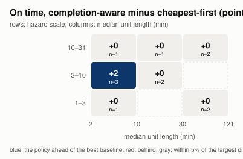
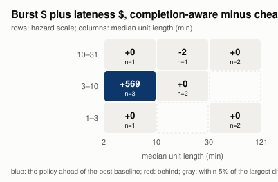
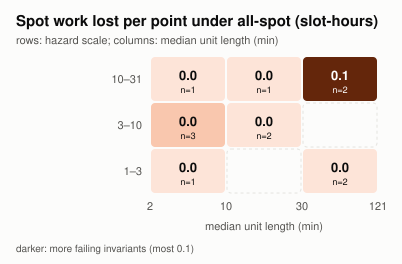

# Spot capacity by provider

`go run ./hack/stress -quick` ran 12 spot points (a Latin hypercube over provider, interruption band and diversification, capacity-crunch scale, discount, maximum price, Azure eviction, AWS rebalance recommendations, checkpoint write time, farm size, load, deadlines and unit length) under four policies, in 1s. Each point's burst capacity is an on-demand pool and a spot pool per pool class; the provider models and every assumed number are in `hack/stress/spot.go`.

- `all-spot`: `sched.Decide` with only the spot pools.
- `all-on-demand`: only the on-demand pools.
- `cheapest-first`: both; `sched.Decide` picks the cheaper pool (spot) first.
Every policy has the same burst ceiling: a policy with one pool gets both pools' limits.
- `completion-aware`: both, with the wrapper in `spot.go` moving a unit to on-demand when its expected interruption loss (hazard x remaining time x (work since its last checkpoint + lateness cost of the delay)) exceeds the on-demand premium, and checkpointing or moving units on a rebalance recommendation or a notice.

## By provider

Means per point; cost is burst spend (spot and on-demand), lost is spot work thrown away by interruptions.

| Provider  | Policy             | On time | Burst $ per point | Lateness $ per point | Lost slot-hours per point | Interruptions | Units killed | Saves on a warning | Units moved on demand |
| --------- | ------------------ | ------- | ----------------- | -------------------- | ------------------------- | ------------- | ------------ | ------------------ | --------------------- |
| aws (4)   | `all-spot`         | 100.0%  | $45               | $0                   | 0.0                       | 0             | 0            | 0                  | 0                     |
| aws (4)   | `all-on-demand`    | 100.0%  | $197              | $0                   | 0.0                       | 0             | 0            | 0                  | 0                     |
| aws (4)   | `cheapest-first`   | 100.0%  | $98               | $0                   | 0.0                       | 0             | 0            | 0                  | 0                     |
| aws (4)   | `completion-aware` | 100.0%  | $98               | $0                   | 0.0                       | 0             | 0            | 0                  | 0                     |
| gcp (4)   | `all-spot`         | 100.0%  | $17               | $0                   | 0.1                       | 3             | 3            | 0                  | 0                     |
| gcp (4)   | `all-on-demand`    | 100.0%  | $70               | $0                   | 0.0                       | 0             | 0            | 0                  | 0                     |
| gcp (4)   | `cheapest-first`   | 100.0%  | $31               | $0                   | 0.2                       | 2             | 2            | 0                  | 0                     |
| gcp (4)   | `completion-aware` | 100.0%  | $31               | $0                   | 0.2                       | 2             | 2            | 0                  | 0                     |
| azure (4) | `all-spot`         | 87.9%   | $33               | $994                 | 0.0                       | 2             | 2            | 0                  | 0                     |
| azure (4) | `all-on-demand`    | 87.9%   | $163              | $994                 | 0.0                       | 0             | 0            | 0                  | 0                     |
| azure (4) | `cheapest-first`   | 87.9%   | $37               | $994                 | 0.0                       | 2             | 2            | 0                  | 0                     |
| azure (4) | `completion-aware` | 89.1%   | $43               | $560                 | 0.0                       | 2             | 2            | 0                  | 0                     |

## Exposure by unit length

Spot work lost to interruptions, in slot-hours over all points, by the length of the unit that was running. Short frames lose little when interrupted: the frame granularity is what bounds a render's exposure, and a long unit without checkpoints is what the completion-aware policy keeps off spot.

| Policy             | under 10 min | 10 to 60 min | 1 to 4 h | 4 h or more |
| ------------------ | ------------ | ------------ | -------- | ----------- |
| `all-spot`         | 0.1          | 0.2          | 0.1      | 0.0         |
| `all-on-demand`    | 0.0          | 0.0          | 0.0      | 0.0         |
| `cheapest-first`   | 0.0          | 0.4          | 0.0      | 0.2         |
| `completion-aware` | 0.0          | 0.4          | 0.0      | 0.2         |

## Heatmaps

Over capacity-crunch scale (hazard multiplier) and median unit length in minutes. In the cost map, blue is money saved by the completion-aware policy (burst spend plus lateness cost), red money lost.

## Invariants on spot points

The invariants held on every decision of `cheapest-first` at every spot point.

## Points

| Point | Provider | Nodes | Load | Unit min | Hazard x | Band | Diversity | Max price | all-spot on time, $ | all-on-demand on time, $ | cheapest-first on time, $ | completion-aware on time, $ |
| ----- | -------- | ----- | ---- | -------- | -------- | ---- | --------- | --------- | ------------------- | ------------------------ | ------------------------- | --------------------------- |
| s000  | aws      | 2     | 1.9  | 4.83     | 29       | 2    | 1         | 0         | 34/34, $2           | 34/34, $6                | 34/34, $2                 | 34/34, $2                   |
| s001  | azure    | 8     | 1.4  | 5.69     | 4.27     | 4    | 6         | 0.79      | 43/43, $78          | 43/43, $465              | 43/43, $83                | 43/43, $83                  |
| s002  | aws      | 4     | 0.94 | 23.7     | 8.24     | 1    | 5         | 0         | 12/12, $0           | 12/12, $0                | 12/12, $0                 | 12/12, $0                   |
| s003  | azure    | 22    | 0.85 | 19.4     | 12.4     | 0    | 1         | 0         | 17/21, $20          | 17/21, $95               | 17/21, $27                | 17/21, $28                  |
| s004  | aws      | 18    | 1.8  | 39.6     | 1.23     | 3    | 4         | 0.61      | 25/25, $57          | 25/25, $434              | 25/25, $190               | 25/25, $190                 |
| s005  | gcp      | 12    | 1.1  | 106      | 20.2     | 3    | 2         | 0         | 8/8, $0             | 8/8, $0                  | 8/8, $0                   | 8/8, $0                     |
| s006  | azure    | 7     | 1.6  | 3.03     | 3.03     | 1    | 3         | 0.7       | 29/41, $35          | 29/41, $93               | 29/41, $37                | 31/41, $63                  |
| s007  | azure    | 5     | 1.1  | 2.06     | 2.01     | 4    | 4         | 0.99      | 15/15, $0           | 15/15, $0                | 15/15, $0                 | 15/15, $0                   |
| s008  | gcp      | 15    | 1.3  | 69.2     | 17       | 2    | 2         | 0         | 25/25, $69          | 25/25, $281              | 25/25, $124               | 25/25, $124                 |
| s009  | gcp      | 3     | 1.2  | 9.01     | 7.03     | 0    | 3         | 0.53      | 12/12, $0           | 12/12, $0                | 12/12, $0                 | 12/12, $0                   |
| s010  | gcp      | 9     | 1.8  | 13.1     | 3.42     | 2    | 5         | 0         | 27/27, $0           | 27/27, $0                | 27/27, $0                 | 27/27, $0                   |
| s011  | aws      | 3     | 1.6  | 46.6     | 1.56     | 1    | 6         | 0.91      | 13/13, $123         | 13/13, $346              | 13/13, $200               | 13/13, $200                 |

Rerun a point with `go run ./hack/stress -point '<encoded point>' -spot`; the encoded points are in `spot.csv`.
